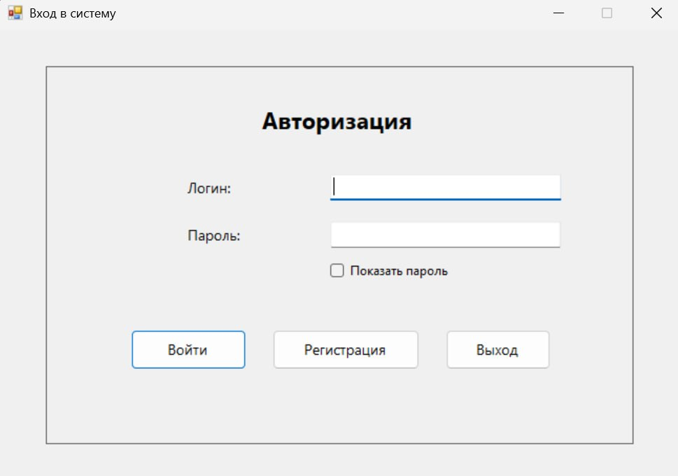
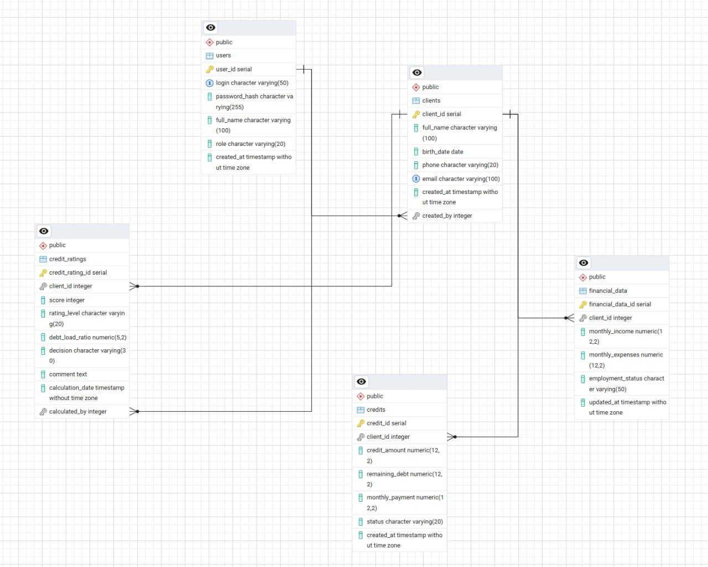

# АИС «Анализ кредитного рейтинга клиентов»

**Курсовой проект по дисциплине «Базы данных», МГТУ им. Н. Э. Баумана (2026).**

Настольная система для хранения сведений о клиентах, доходах, расходах и кредитных обязательствах. Приложение рассчитывает учебный кредитный рейтинг, сохраняет результаты в PostgreSQL и позволяет формировать отчёты.



## Возможности

- Регистрация и авторизация, роли пользователя и администратора.
- Просмотр, поиск, добавление, редактирование и удаление клиентов.
- Учёт финансовых данных и кредитных обязательств.
- Расчёт кредитного рейтинга по введённым данным и просмотр результатов.
- Управление пользователями и отчётность для администратора.

## Технологии

**C#**, **Windows Forms**, **.NET Framework 4.8**, **PostgreSQL**, **SQL**, **Npgsql**, Visual Studio 2022, pgAdmin 4.

## Проектирование

В курсовой работе подготовлены техническое задание, DFD, IDEF0, инфологическая модель в нотации Чена, даталогическая модель, структурная схема, граф диалога и программа испытаний.

Основные сущности: `users`, `clients`, `financial_data`, `credits`, `credit_ratings`.



[Модель Чена](docs/diagrams/conceptual-model.png) · [DFD](docs/diagrams/dfd-level-0.jpg) · [Декомпозиция DFD](docs/diagrams/dfd-decomposition.jpg) · [IDEF0](docs/diagrams/idef0.png)

## Документация

- [Техническое задание (PDF)](docs/technical-specification.pdf) / [DOCX](docs/technical-specification.docx)
- [Расчётно-пояснительная записка (PDF)](docs/course-report.pdf) / [DOCX](docs/course-report.docx)

## Запуск

1. Установить Windows, PostgreSQL и Visual Studio с поддержкой .NET Framework 4.8 и Windows Forms.
2. Создать пустую БД `credit_rating_db` и выполнить [`database/schema.sql`](database/schema.sql) в pgAdmin или psql.
3. Создать пользовательскую переменную среды Windows `CREDIT_RATING_DB_CONNECTION_STRING` со строкой подключения:

   ```text
   Host=localhost;Port=5433;Database=credit_rating_db;Username=postgres;Password=YOUR_LOCAL_PASSWORD
   ```

   Заменить пароль локальным и изменить порт при необходимости. Перезапустить Visual Studio.
4. Открыть `kursovaya.sln`, восстановить NuGet-пакеты, собрать и запустить проект.
5. Зарегистрировать пользователя и добавить демонстрационные данные. Для функций администратора нужна учётная запись с соответствующей ролью.

**Безопасность:** не публикуйте настоящие пароли и персональные данные; `schema.sql` предназначен для структуры БД.

## Структура

```text
credit-rating-system/
├── kursovaya.sln
├── kursovaya/         # исходный код C# WinForms
├── database/schema.sql
├── docs/              # ТЗ, РПЗ, диаграммы, скриншоты
└── README.md
```

## Примечание

Проект учебный. Расчёт рейтинга носит демонстрационный характер и не предназначен для принятия реальных кредитных решений.

**Автор:** Роман Хайдаров · [GitHub](https://github.com/rew-web)
